# Rizer — The Artifact Archive

[](https://github.com/ryushin01/Rizer-The-Artifact-Archive/actions/workflows/ci.yml)


엑스칼리버, 성배, 묠니르, 여의봉 같은 세계 곳곳의 전설이나 판타지 속에 등장하는 유물 100점을 고해상도 딥줌으로 확대해 보고, 사진의 부분마다 달린 해설을 읽는 온라인 전시실입니다. 큐레이터는 관리 화면에서 유물·해설·이미지 주석을 편집합니다.

**[전시실 보기](https://rizer-ryushin01.vercel.app/)** · **[관리 화면 보기](https://rizer-admin-ryushin01.vercel.app/login)**: 로그인 화면에서 **게스트로 둘러보기**를 누르면 읽기 전용으로 들어갑니다. · **[디자인 시스템(Storybook)](https://rizer-ryushin01.vercel.app/storybook/index.html)**

> **프로젝트 상태:** 포트폴리오 프로젝트입니다. 전설 속 유물은 실물이 없으므로, 모습이 닮은 실제 소장품의 공개 도메인(CC0) 사진을 빌려 쓰고, 출처는 아래 [출처](#출처)에 밝힙니다. 해설·주석·합성 이미지는 이 프로젝트에서 새로 만들었습니다.

## 화면

사진은 [메트로폴리탄 미술관](https://www.metmuseum.org/hubs/open-access)·[클리블랜드 미술관](https://www.clevelandart.org/open-access) Open Access(CC0)이고, 계정·주석은 개발용 시드 데이터입니다.

### 공개 사이트

| 첫 화면                                                                                       | 컬렉션                                                                          |
| --------------------------------------------------------------------------------------------- | ------------------------------------------------------------------------------- |
| 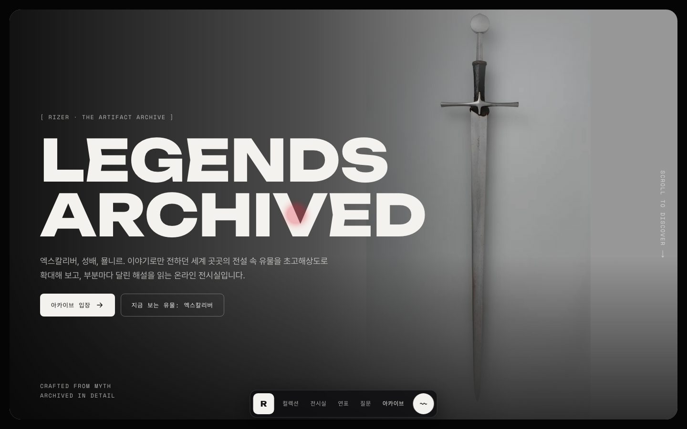 | 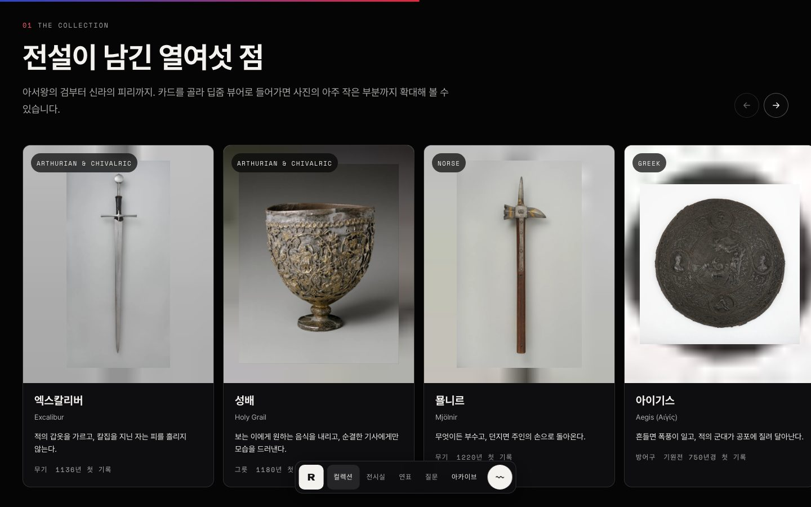 |

| 딥줌 뷰어와 주석                                                                                           | 합성 이미지(천부인)                                                                              |
| ---------------------------------------------------------------------------------------------------------- | ------------------------------------------------------------------------------------------------ |
| 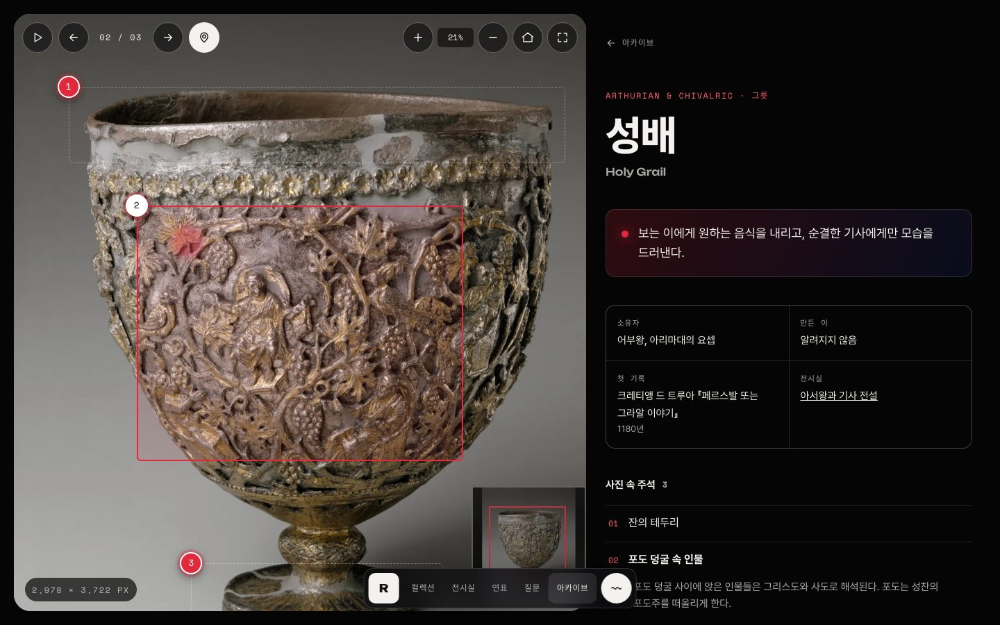 | 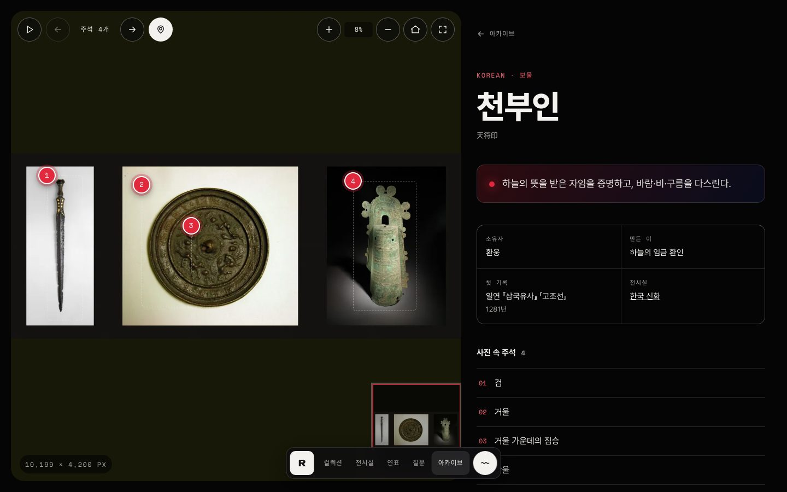 |

| 전승 지도 | 영어판 |
|---|---|
| 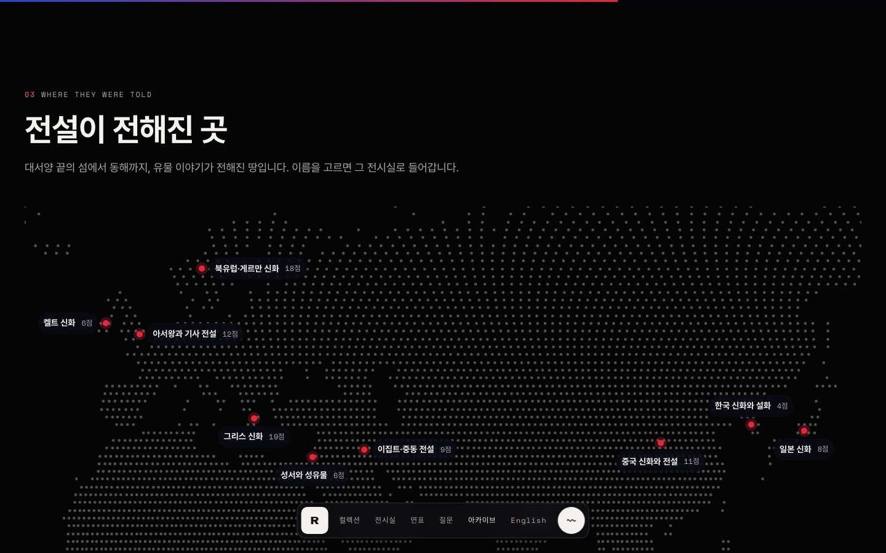 | 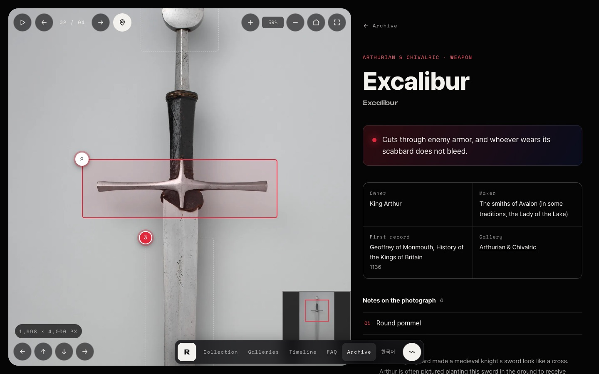 |

| 아카이브 검색                                                                                              | 입장 화면                                                          | 모바일                                                                                             |
| ---------------------------------------------------------------------------------------------------------- | ------------------------------------------------------------------ | -------------------------------------------------------------------------------------------------- |
| 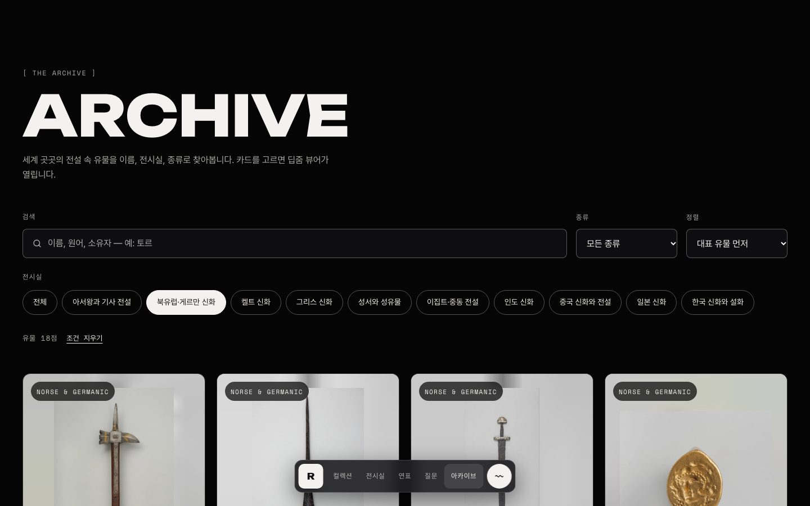 | 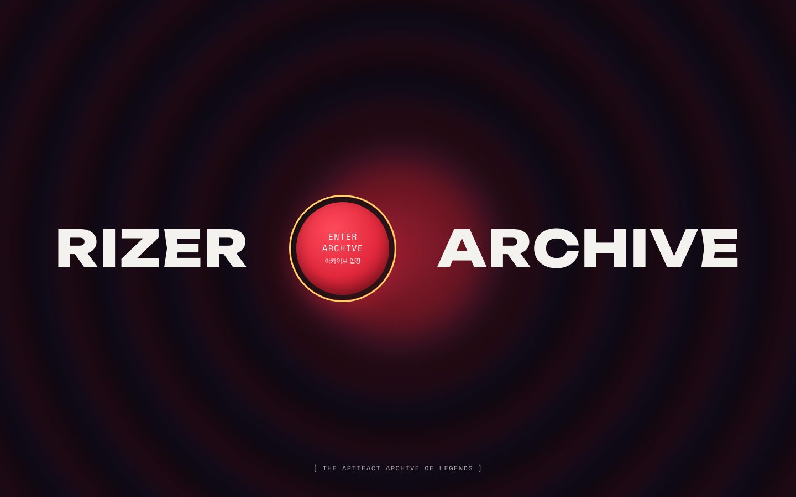 | 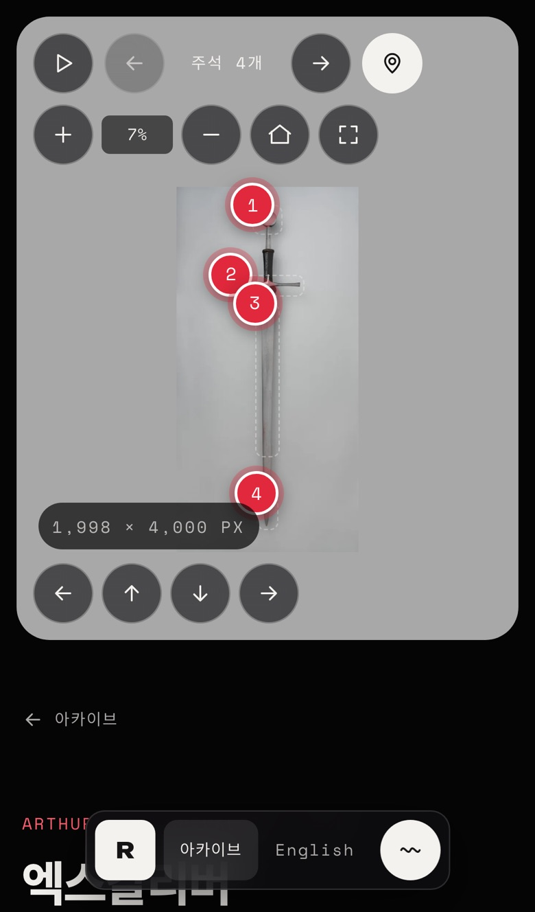 |

### 관리 화면

| 주석 편집기                                                                                                            | 대시보드                                                                                |
| ---------------------------------------------------------------------------------------------------------------------- | --------------------------------------------------------------------------------------- |
| 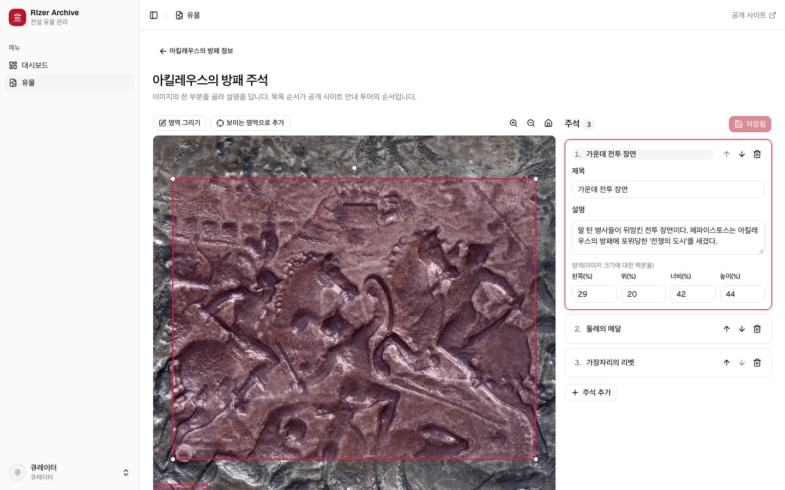 | 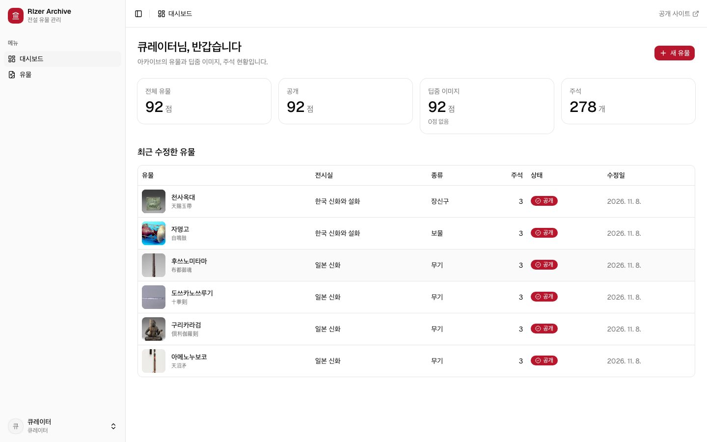 |

## 주요 기능

| 영역        | 내용                                                                                                                                                                                                                                        |
| ----------- | ------------------------------------------------------------------------------------------------------------------------------------------------------------------------------------------------------------------------------------------- |
| 공개 사이트 | 입장 화면, 스크롤 연출(고정 문장·컬렉션·열 개 전시실·전승 지도·시대별 첫 기록 연표·질문), 아카이브 검색(이름·해설·주석 본문까지, 전시실·종류·정렬, 주소 동기화, 24점씩 "더 보기"), 영어판(`/en`, 유물 100점 해설·주석 번역)                 |
| 딥줌 뷰어   | DZI 타일, 키보드 확대·이동, 끌기 없이 누르는 이동 버튼, 주석 번호 버튼, 안내 투어(자동 재생·멈춤), 주석 바로가기 링크(`?note=N`), 미니맵, 전체 화면, 유물별 공유 이미지                                                                                                 |
| 관리 화면   | 유물 목록(검색·전시실·상태, 30점씩 쪽 나누기), 유물 작성·수정·공개·삭제, 원본 업로드와 타일 생성, 주석 편집기(끌어서 그리기 + 키보드용 '보이는 영역으로 추가'·숫자 입력, W3C Web Annotation JSON 내보내기·가져오기), 게스트(읽기 전용) 계정 |
| 연동        | 관리 화면에서 저장하면 공개 사이트 캐시를 바로 비운다(캐시 태그)                                                                                                                                                                            |
| 접근성      | 본문 바로가기, 움직임 끄기(KWCAG 6.2.2), 색 대비 4.5:1, 스토리·E2E axe 검사, [KWCAG 2.2 점검 기록](docs/accessibility.md)                                                                                                                   |

## 기술 스택


| 구분        | 사용 기술                                                                                                                              |
| ----------- | -------------------------------------------------------------------------------------------------------------------------------------- |
| 공통        | pnpm 워크스페이스 + Turborepo, Next.js 16 (App Router, Cache Components), React 19, TypeScript, zod                                    |
| 공개 사이트 | styled-components, Redux Toolkit + redux-saga, OpenSeadragon, UnifrakturCook·Song Myung·Nanum Myeongjo·Nanum Gothic Coding                                          |
| 관리 화면   | shadcn/ui(Base UI) + Tailwind CSS 4, Drizzle ORM + PostgreSQL(개발·테스트는 PGlite), Auth.js, Annotorious                              |
| 이미지·배포 | sharp(DZI 타일·미리보기·LQIP), Vercel Blob(S3 호환 R2 드라이버도 있음), Vercel                                                         |
| 품질        | ESLint(FSD 경계 규칙), Vitest + Testing Library, redux-saga-test-plan, Storybook 10 스토리 테스트(axe), Playwright E2E, eslint-plugin-jsx-a11y, size-limit, Lighthouse CI, GitHub Actions |
| 모니터링 | Sentry(DSN이 있을 때만), web-vitals |

## 시작하기

Node.js 24(`.node-version`)와 pnpm 12가 필요합니다.

```bash
pnpm install
pnpm dev           # 관리 화면 http://localhost:3000, 공개 사이트 http://localhost:3001
```

시드 유물 100점의 딥줌 타일은 저장소에 들어 있습니다. 관리 화면은 **게스트로 둘러보기**(읽기 전용) 또는 `curator@rizer.dev` / `rizer1234`(개발용)로 들어갑니다.

| 명령                               | 설명                                            |
| ---------------------------------- | ----------------------------------------------- |
| `pnpm typecheck` / `lint` / `test` | 타입 검사 / 린트 / 단위 테스트 (전체 앱·패키지) |
| `pnpm test:storybook`              | 모든 스토리를 Chromium에서 그리고 접근성 검사   |
| `pnpm e2e`                         | 두 앱을 프로덕션 빌드로 띄워 E2E 검사           |
| `pnpm --filter @rizer/web size` / `lhci` | 공개 사이트 번들 크기 / Lighthouse 기준 검사 (먼저 빌드 필요) |
| `pnpm build`                       | 프로덕션 빌드                                   |
| `pnpm tiles <원본> <출력 폴더>`    | 큰 원본을 로컬에서 딥줌 타일로 자르기           |

## 프로젝트 구조

```
apps/
├─ web/        공개 사이트 (3001) — styled-components, Redux + saga, 딥줌 뷰어, E2E(e2e/)
└─ admin/      관리 화면·공개 API (3000) — shadcn/ui, Drizzle, Auth.js, 주석 편집기
packages/
├─ domain/     유물·주석(W3C Web Annotation) 스키마, 공개 API 계약, 시드 유물 100점
├─ tiles/      sharp 딥줌 타일 생성과 CLI
├─ storage/    로컬·S3(R2)·Vercel Blob 스토리지
├─ ui/         shadcn/ui 컴포넌트와 테마 (관리 화면)
└─ config/     tsconfig, ESLint(FSD 경계), 보안 헤더
```

## 문서

| 문서                                 | 내용                                                       |
| ------------------------------------ | ---------------------------------------------------------- |
| [개발 가이드](docs/development.md)   | 명령, 환경 변수, 시드 이미지, 테스트                       |
| [아키텍처](docs/architecture.md)     | 앱 구성, 데이터 흐름, 딥줌·주석, 상태 관리, 접근성         |
| [배포](docs/deployment.md)           | Vercel 프로젝트 둘, Neon, Vercel Blob, 시드 타일 정적 제공 |
| [접근성 점검](docs/accessibility.md) | KWCAG 2.2 33개 항목별 점검 기록과 한계                     |
| [이미지 출처](docs/credits.md)       | 유물별 사진 출처와 라이선스                                |
| [변경 기록](CHANGELOG.md)            | 버전별 변경 사항                                           |

## 출처

| 자료 | 저작자 | 사용 허락 | 원본 |
|---|---|---|---|
| 유물 사진 (전설 속 유물과 모습이 닮은 실제 소장품) | 메트로폴리탄 미술관, 클리블랜드 미술관 | CC0 (Open Access) | [The Met Open Access](https://www.metmuseum.org/hubs/open-access) · [Cleveland Open Access](https://www.clevelandart.org/open-access) |
| UnifrakturCook 글꼴 (공개 사이트 제목) | j. 'mach' wust, Peter Wiegel | SIL OFL 1.1 | [Google Fonts](https://fonts.google.com/specimen/UnifrakturCook) |
| Song Myung(송명) 글꼴 (공개 사이트) | The Song Myung Project Authors | SIL OFL 1.1 | [Google Fonts](https://fonts.google.com/specimen/Song+Myung) |
| Nanum Myeongjo(나눔명조) 글꼴 (공개 사이트) | NHN(네이버), 디자인 FONTRIX | SIL OFL 1.1 | [Google Fonts](https://fonts.google.com/specimen/Nanum+Myeongjo) |
| Nanum Gothic Coding(나눔고딕코딩) 글꼴 (공개 사이트) | NHN(네이버), 디자인 산돌커뮤니케이션 | SIL OFL 1.1 | [Google Fonts](https://fonts.google.com/specimen/Nanum+Gothic+Coding) |
| Geist · Geist Mono 글꼴 (관리 화면) | The Geist Project Authors(Vercel) | SIL OFL 1.1 | [vercel/geist-font](https://github.com/vercel/geist-font) |
| Pretendard 글꼴 (공유 이미지) | 길형진(orioncactus) | SIL OFL 1.1 | [orioncactus/pretendard](https://github.com/orioncactus/pretendard) |

유물마다 사진 속 실제 소장품과 등록 번호는 [이미지 출처](docs/credits.md)에 있습니다. 해설·주석과 합성 이미지는 이 프로젝트에서 만들었고, 사이트 바닥글의 '이미지·글꼴 출처' 링크가 이 표로 옵니다.
