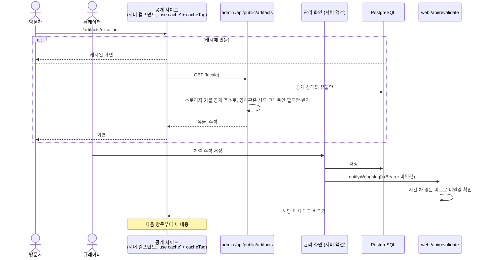
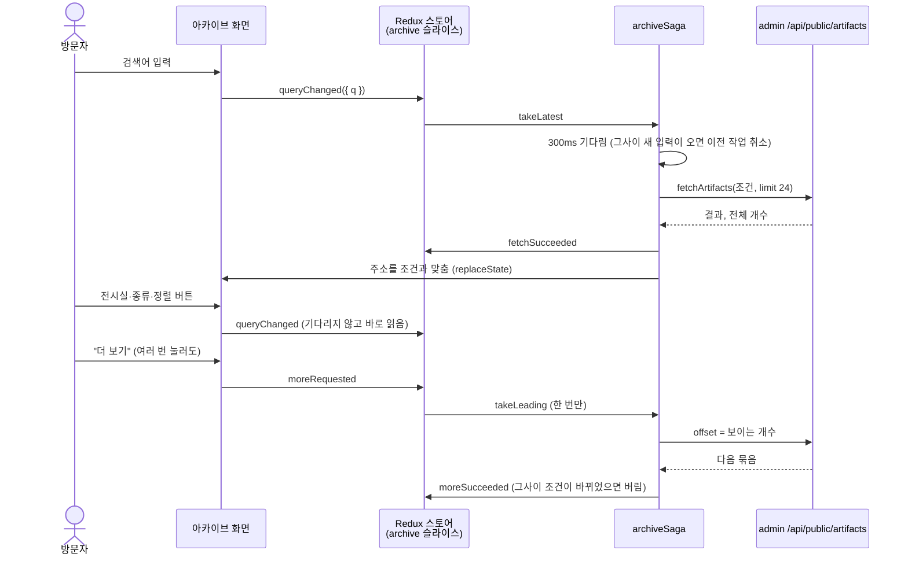
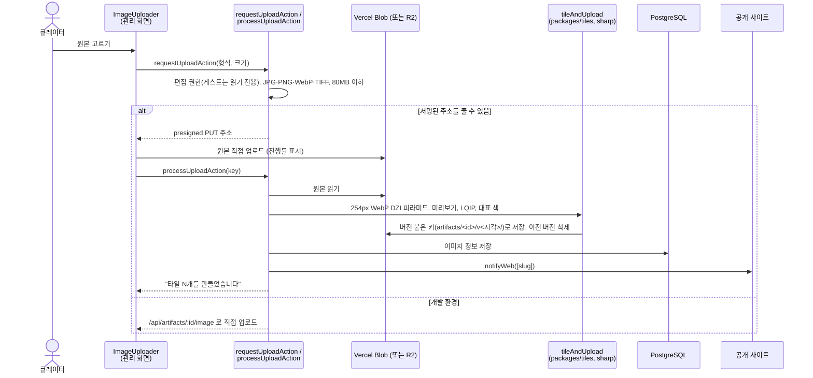

# 시퀀스 다이어그램

RIzer의 주요 흐름입니다. 구성 설명은 [아키텍처](architecture.md)에 있고, 여기서는 시간 순서로 그립니다.

## 1. 공개 사이트 조회와 저장 후 갱신

관리 화면(`apps/admin`)이 데이터의 주인이고, 공개 사이트(`apps/web`)는 공개 API를 캐시해 읽습니다.

## 2. 아카이브 검색 (redux-saga)

## 3. 원본 업로드와 딥줌 타일 생성

